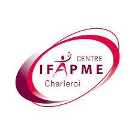
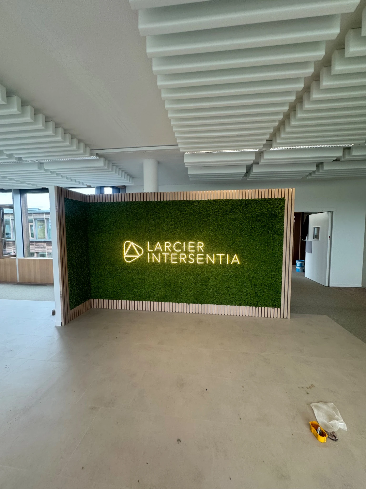
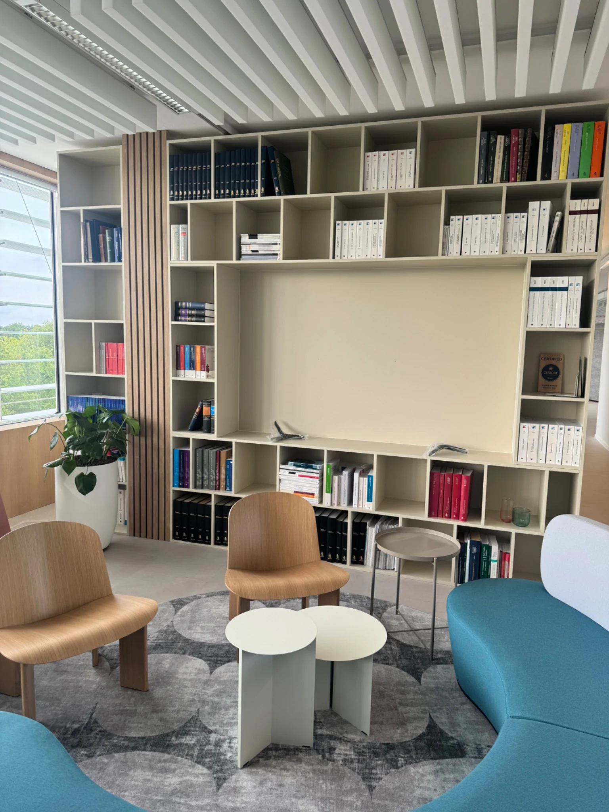
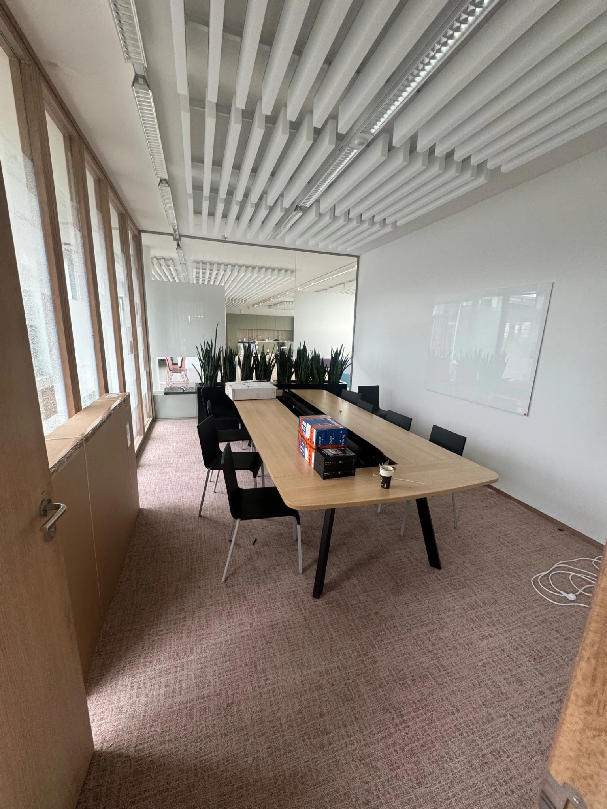
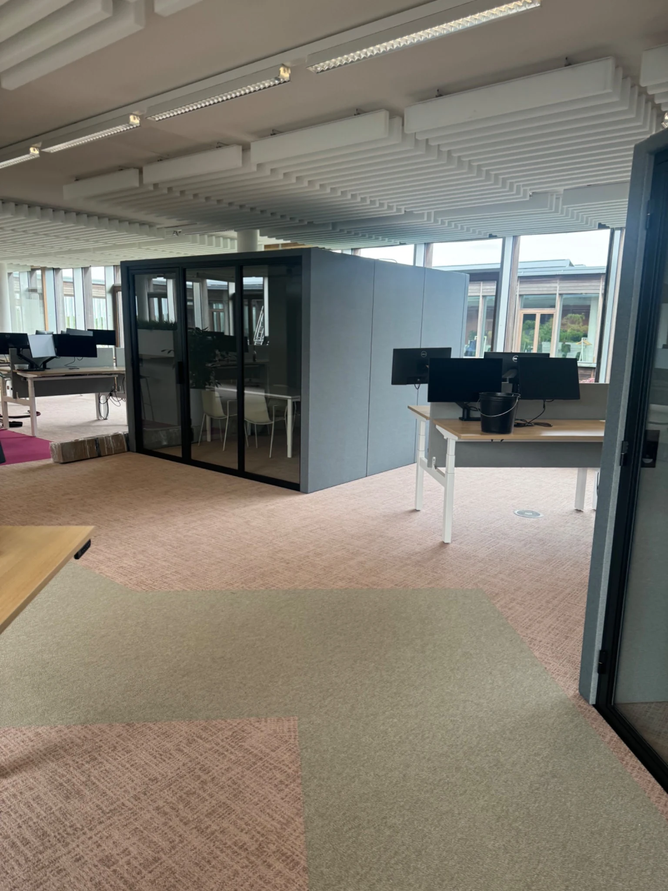
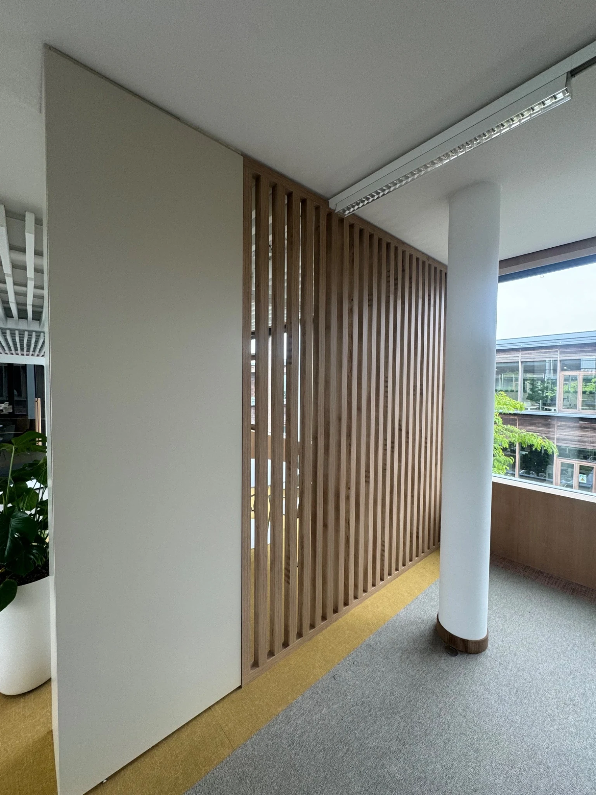
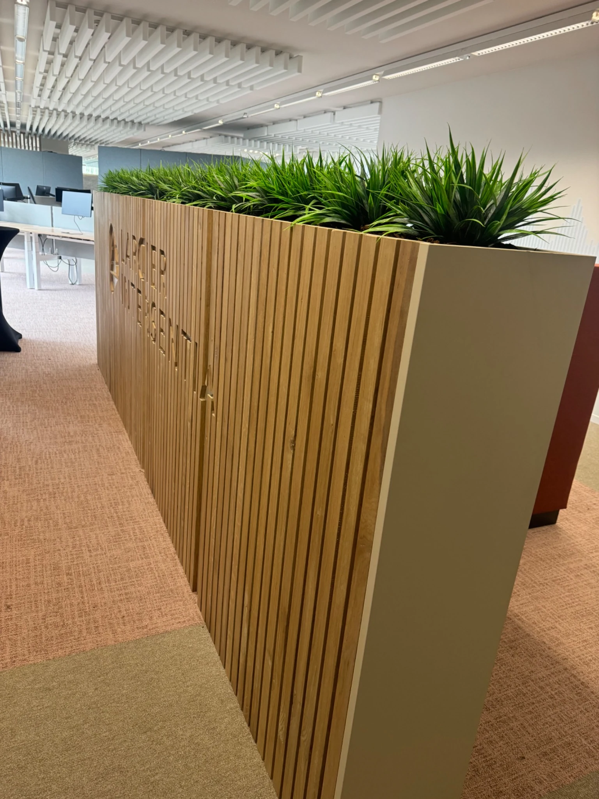
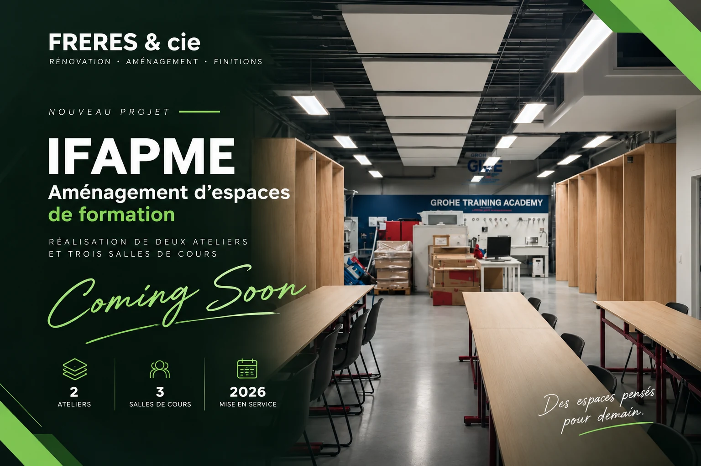

# Aperçu du nouveau site FRERES & cie

**Version de travail — pas encore publiée sur compagniefreres.com.**

Ce document permet de voir **directement sur GitHub** les vrais visuels sélectionnés. Il ne s'agit pas d'un rendu interactif de la page web : pour apprécier le comportement exact du menu et des animations, il faudra un aperçu hébergé.

## 1. Nouvel accueil — logos discrets

**Ils nous font confiance**

<table>
<tr>
<td align="center" width="33%"></td>
<td align="center" width="33%"></td>
<td align="center" width="33%">**Larcier Intersentia**</td>
</tr>
</table>

Sur le vrai site, cette zone sera **une bande fine**, avec les trois logos harmonisés, sans longs textes ni grandes cartes. Le reste de l'accueil ne change pas.

## 2. Réalisation Larcier Intersentia

**Aménagement de bureaux — Louvain-la-Neuve**

Photo principale : le mur végétal avec la signature Larcier Intersentia.

### Galerie des espaces de travail

<table>
<tr>
<td width="50%">
<strong>Espace accueil et lounge</strong>
</td>
<td width="50%">
<strong>Salle de réunion</strong>
</td>
</tr>
<tr>
<td>
<strong>Open space</strong>
</td>
<td>
<strong>Finitions bois</strong>
</td>
</tr>
<tr>
<td colspan="2" align="center">
<strong>Séparations et végétal</strong>
</td>
</tr>
</table>

**Qualité préservée :** les photos sont enregistrées en WebP haute qualité à 1 536 × 2 048 pixels. Touchez une photo pour l'ouvrir en grand, sans traitement par IA.

## 3. IFAPME reste présent

Le projet IFAPME et la galerie des réalisations précédentes sont conservés sur la page Références. Le visuel « Coming Soon » validé n'a pas été remplacé.

---

**Pour vérification des modifications :** [Voir le code proposé sur GitHub](https://github.com/alessandro781227/freres-compagnie-site1/pull/4/files).

**Publication :** aucune modification de la branche publique `main` lors de la préparation de cet aperçu.
